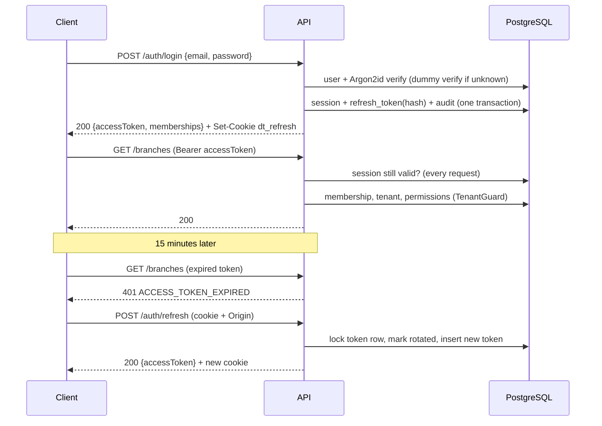
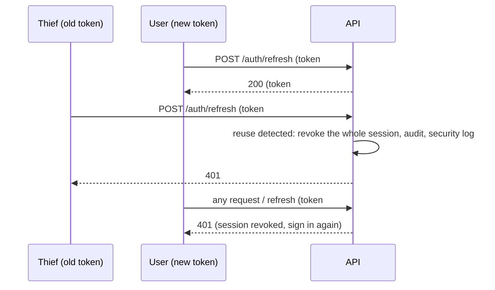

# Authentication (Phase 3)

Source of truth for how people sign in. Design and decisions: [plans/02-authentication.md](../plans/02-authentication.md) and ADR-0011, -0012, -0013. Code: `src/modules/auth` (`session/`, `password/`, `flows/`), `src/modules/users`, `src/modules/mail`, `src/modules/maintenance`.

## The model in one minute

- **Passwords** are hashed with Argon2id. Policy: 10–128 characters (counted as Unicode code points, NFKC-normalised), not on the bundled common-password list, not containing the account's email. No composition rules.
- **Access token**: a JWT (HS256, 15 minutes) carrying only `sub` (user), `sid` (session), `typ` (`staff`), `iat`, `exp`, `iss`, `aud`. It has **no tenant, role or permission**, so none of those can be stale.
- **Session**: a database row per sign-in (14 days idle, 30 days absolute). `JwtAuthenticator` re-reads it on **every** request, so logout, password change/reset and deactivation take effect on the next request. The **active tenant lives on the session** and is changed by `POST /auth/switch-tenant`; it also takes effect on the next request.
- **Refresh token**: 256 random bits, stored only as a SHA-256 hash, delivered **only** in an httpOnly cookie. Each use rotates it; presenting an already-rotated one revokes the whole session (reuse detection, no grace window).
- **Emails** are queued in the same transaction as the change that causes them and sent after commit by the outbox relay.

## Endpoints (all under `/api/v1`)

| Endpoint | Auth | Result |
|---|---|---|
| `POST /auth/login` | public | `200` access token, user, memberships, active tenant; refresh cookie. Generic `401 INVALID_CREDENTIALS`. |
| `POST /auth/refresh` | public (cookie + `Origin`) | `200` new access token; cookie rotated. |
| `POST /auth/logout`, `/auth/logout-all` | signed in (+ `Origin`) | `204`; session(s) revoked; cookie cleared. |
| `POST /auth/switch-tenant` | signed in | `200` new active tenant + permissions there. `403 TENANT_ACCESS_DENIED / TENANT_SUSPENDED / TENANT_DEACTIVATED`. |
| `POST /auth/password/forgot` | public | **Always** `202`, whether or not the email has an account. |
| `POST /auth/password/reset` | public (token) | `204`; every session revoked. `400 TOKEN_INVALID` or `VALIDATION_FAILED`. |
| `POST /auth/account/setup` | public (token) | `204`; activates an onboarded `pending` owner. |
| `POST /invitations/accept` | public (token) | `204`; joins the clinic. No automatic sign-in. |
| `GET /me`, `/me/memberships`, `/me/sessions` | signed in | Profile + permissions in the active tenant / memberships / active sessions. |
| `DELETE /me/sessions/:id` | signed in | `204`; another user's session id is `404`. |
| `POST /me/password` | signed in | `204`; other sessions revoked, this one kept; a "password changed" email. |
| `POST /invitations`, `POST /invitations/:id/resend` | `members.invite` | Create / resend (new token, old link dies). |

Every `/auth/*` and `/me*` response carries `Cache-Control: no-store`.

## The refresh cookie

`dt_refresh`: `HttpOnly`, `SameSite=Strict`, `Path=/api/v1/auth`, `Secure` everywhere except `NODE_ENV=development`, `Max-Age` = remaining absolute lifetime. `refresh`, `logout` and `logout-all` also require an `Origin` header listed in `CORS_ALLOWED_ORIGINS` (else `403 FORBIDDEN`). The frontend and the API must share a site, and `CORS_ALLOW_CREDENTIALS` must be `true`. The client keeps the access token in memory and **must serialise its refresh calls**: two concurrent refreshes with one token are treated as reuse and sign the user out.

## Throttling and lockout

`ThrottlerGuard` is the first global guard (in memory, per process; health is exempt).

| Route | Limit |
|---|---|
| everything else | 300 / minute / IP |
| `POST /auth/login` | 5 / 15 min per IP + email **and** 30 / 15 min per IP |
| `POST /auth/refresh` | 30 / minute / IP |
| `password/forgot`, `password/reset`, `account/setup`, `invitations/accept` | 5 / 15 min / IP |
| `POST /me/password` | 5 / 15 min / user |

Over the limit: `429 RATE_LIMITED` with `Retry-After`. **Lockout:** 10 consecutive failed logins for an existing active user lock the account for 15 minutes; a locked login answers with the same `429`, even with the right password, so the response never says whether an account exists. The counter is not reset when the lock expires (the next failure locks again); a success, password reset or account setup clears it.

## Email

Services call `MailQueue.enqueue(tx, kind, payload)` inside their transaction; after commit the relay (polls every second; 10 attempts with backoff) runs the `@OnOutboxMessage` handler, which renders and sends. At-least-once: a duplicate is acceptable, a lost email is not. Links go to the frontend (`APP_PUBLIC_URL`) with the token in the **URL fragment** (`/reset-password#token=…`), which browsers never send to a server. Kinds: `password_reset`, `password_changed`, `account_setup`, `clinic_owner`, `invitation`.

Transports (`MAIL_TRANSPORT`): `log` (development default, logs the message including links: never use it where logs are shipped), `file` (`var/mail`, gitignored), `memory` (tests), `smtp` (`SMTP_URL`; **required in production**). The outbox tables live in the `nest_outbox` schema, created by our Prisma migration; the store runs with `migrate: false`.

The queued payload contains the raw token until the email is delivered (and in `nest_outbox.dead_letters` if delivery keeps failing; the cleanup job purges those after 14 days). See ADR-0013.

## Account flows

- **Onboarded owners** are created `pending`. Onboarding issues a 7-day single-use setup link in the same transaction; an owner who already has an active account instead gets an ownership notice. `POST /auth/account/setup` sets the password and activates the user.
- **Invitations**: one role each (never `owner`), 7 days, at most one open invitation per email per clinic (a partial unique index). Accepting needs only the token for an existing active user; a new or still-`pending` user must also send `fullName` and `newPassword`. A deactivated user cannot be brought back this way. A removed membership is re-activated with the newly invited role.
- **Password reset/change** revoke sessions (reset: all; change: all others) and queue a "password changed" email.

## Housekeeping

`CleanupJob` runs daily at 03:00 Asia/Manila: deletes `user_tokens` expired or used more than 7 days ago; sessions revoked or expired more than 30 days ago (with their refresh tokens); dead letters older than 14 days; outbox inbox records older than 30 days. Expired invitations and audit logs are never deleted. It is idempotent, so it is safe on several instances.

## Audit events

`auth.login`, `auth.login_failed` (existing accounts only), `auth.logout`, `auth.logout_all`, `auth.refresh_reuse_detected`, `auth.tenant_switched` (tenant = the new one), `auth.password_reset_requested`, `auth.password_reset`, `auth.password_changed`, `auth.account_setup`, `auth.session_revoked`, `invitation.created`, `invitation.resent`, `invitation.accepted`. Field names only; never a password, token or email body.

## Testing helpers

`createTestApp({ productionAuthenticator: true, clock })` uses the real `JwtAuthenticator`; `TestClock` moves time without sleeping; the mail transport is always in memory (`mailbox(app)`, `deliverMail(app)` drives the relay because `OUTBOX_RELAY=off` in tests, `tokenFromLink`); `ResettableThrottlerStorage.reset()` clears rate-limit counters between cases (the real limits stay in force); `createActiveUser`, `setPasswords` and `seedMembership` (`test/support/auth.ts`) create users with known passwords. `.env.test` lowers the Argon2 cost for speed (production refuses lowered values).
